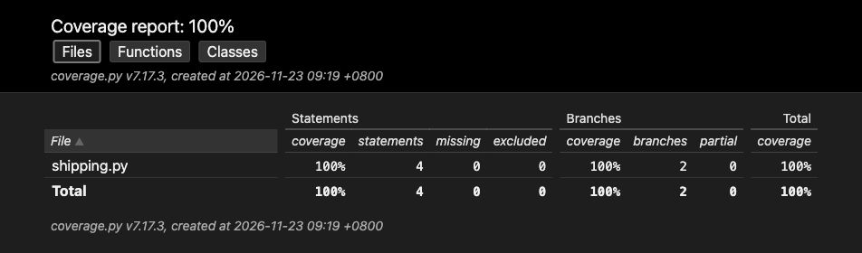

# Python coverage for WebAssembly


Measure Python line and branch coverage in Wasm and native Python in the same
`pytest` run. `coverage-wasm` is an independent add-on for [`coverage.py`]. It
feeds guest measurements to `pytest-cov` so both environments appear in one
report.

## Install

Use host CPython 3.11 or newer and `pytest` 8.4 or newer. To install the current
development version in your test project, run:

```sh
uv add --dev git+https://github.com/alex-au-922/coveragepy-wasm.git --branch main
```

For a pinned source install, use `--tag` with an [existing tag]. Stable
releases can be installed from PyPI with `uv add --dev coverage-wasm`.

## Run tests with coverage

Pick the guide for the runtime that runs your Python code.

| Runtime | Start here |
| --- | --- |
| [Pyodide] | Use a `pytest-pyodide` fixture and collect automatically. |
| [Workerd] | Pass a built Python Worker bundle to `targets.wrangler()`. |
| [CPython on WASI] | Pass your script and filesystem grants to `targets.wasi()`. |

```sh
uv run pytest --cov --cov-report=html
```

`pytest` prints `Wasm coverage enabled` and lists how many tests contributed
guest data. Open `htmlcov/index.html` for the merged report. Use
[Coverage configuration] to map guest filenames to your source tree and set a
coverage threshold.



In the [Pyodide example][pyodide-example], one test runs in Pyodide and one runs
in native Python. They cover opposite branches of `shipping.py`.

[`coverage.py`]: https://coverage.readthedocs.io/
[existing tag]: https://github.com/alex-au-922/coveragepy-wasm/tags
[Pyodide]: pyodide.md
[Workerd]: workerd.md
[CPython on WASI]: wasi.md
[Coverage configuration]: configuration.md
[pyodide-example]: https://github.com/alex-au-922/coveragepy-wasm/tree/main/examples/pyodide
